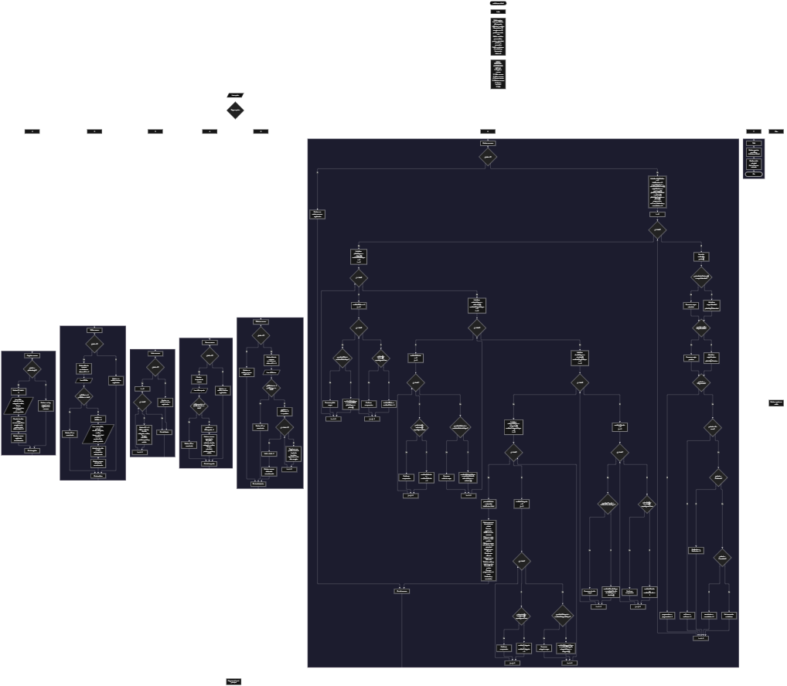

Este proyecto, llamado <b>autódromo virtual</b>, fue desarrollado en <b>java</b> como un ejercicio práctico para fortalecer la lógica de programación mediante la creación de un sistema de gestión de carreras automovilísticas desde la consola. El programa cuenta con un menú principal de siete opciones que permite <b>registrar, editar, listar, buscar, eliminar y consultar un resumen</b> de las carreras registradas. Cada carrera almacena información como el nombre del piloto, el vehículo, el circuito, la categoría, la cantidad de vueltas, el tiempo total, la velocidad máxima, la posición final, los puntos obtenidos y el estado de la carrera, utilizando arreglos con una capacidad máxima de <b>10 carreras durante la ejecución</b>. Durante su desarrollo se aplicaron conceptos fundamentales de programación, como variables, arreglos, estructuras condicionales, ciclos repetitivos y estructuras de selección, además de procesos para buscar, modificar, eliminar y organizar registros. También se incorporaron cálculos estadísticos para identificar los mejores resultados y las frecuencias de los datos almacenados. Este proyecto permite poner en práctica los conocimientos adquiridos en Java y sirve como base para desarrollar sistemas de gestión más avanzados.

<h2 align="center">⚙️ Funcionamiento del menú principal</h2>

### ➕ Registrar carrera

La opción <b>1) registrar carrera</b> permite almacenar una nueva carrera en el sistema. Antes de realizar el registro, el programa comprueba que la cantidad de carreras almacenadas sea menor a la capacidad del arreglo <b>pilotos.length</b>, utilizando la condición <b>total &gt;= pilotos.length</b> para identificar si se alcanzó el límite de registros. Si existe espacio disponible, muestra un identificador generado mediante <b>total + 1</b> y solicita el <b>nombre del piloto, vehículo, circuito, categoría, cantidad de vueltas, tiempo total, velocidad máxima, posición final, puntos obtenidos y estado</b> de la carrera. Los datos se almacenan en la posición correspondiente de sus respectivos arreglos. Finalmente, incrementa la variable <b>total</b> en uno y muestra el mensaje <b>"carrera registrada correctamente."</b>. Si se alcanza la capacidad máxima de 10 carreras, presenta el mensaje <b>"no hay espacio para registrar más carreras."</b>, impidiendo agregar otro registro.

### ✏️ Editar carrera

La opción <b>2) editar carrera</b> permite modificar la información de una carrera registrada. Primero, el programa comprueba si existen carreras almacenadas mediante la variable <b>total</b>. Si no hay registros, muestra el mensaje <b>"no existen carreras registradas."</b>. En caso contrario, presenta una lista con el ID, piloto, vehículo, circuito, categoría, vueltas, tiempo, velocidad máxima, posición, puntos y estado de cada carrera. Después, solicita el ID de la carrera que se desea editar y comprueba que esté dentro del rango permitido mediante la condición <b>idEditar &gt;= 1 &amp;&amp; idEditar &lt;= total</b>. Si la selección es válida, calcula la posición utilizando <b>idEditar - 1</b> y solicita nuevamente los diez datos de la carrera, actualizando directamente los valores de los arreglos correspondientes. Finalmente, muestra el mensaje <b>"carrera actualizada correctamente."</b>. Si el ID introducido no corresponde a una carrera registrada, presenta el mensaje <b>"ID no encontrada."</b>.

### 📋 Listar carreras

La opción <b>3) listar carreras</b> permite visualizar todas las carreras registradas actualmente en el sistema. Antes de mostrar la información, el programa comprueba si la variable <b>total</b> es igual a cero. Si no existen registros, presenta el mensaje <b>"no existen carreras registradas."</b>. Si hay carreras disponibles, utiliza un ciclo <b>for</b> para recorrer los arreglos desde la primera posición hasta el número total de carreras registradas. Durante el recorrido, muestra el ID, piloto, vehículo, circuito, categoría, vueltas, tiempo, velocidad máxima, posición, puntos y estado de cada carrera. Esta función facilita consultar todos los registros almacenados sin necesidad de buscar cada carrera individualmente.

### 🔎 Buscar carrera

La opción <b>4) buscar carrera</b> permite localizar una carrera mediante su identificador. Primero, el programa comprueba si existen carreras registradas. Si el sistema está vacío, muestra el mensaje <b>"no existen carreras registradas."</b>. En caso contrario, solicita el ID de la carrera que se desea buscar y verifica que esté dentro del rango válido mediante la condición <b>idBusqueda &gt;= 1 &amp;&amp; idBusqueda &lt;= total</b>. Si el identificador es correcto, obtiene la posición mediante <b>idBusqueda - 1</b> y muestra todos los datos de la carrera encontrada. Si el ID introducido no corresponde a ningún registro, presenta el mensaje <b>"ID no encontrada."</b>. La búsqueda se realiza directamente mediante el índice de los arreglos, sin utilizar un ciclo de búsqueda.

### 🗑️ Eliminar carrera

La opción <b>5) eliminar carrera</b> permite eliminar una carrera registrada mediante su identificador. Antes de comenzar, el programa comprueba que existan carreras almacenadas. Si no hay registros, muestra el mensaje <b>"no existen carreras registradas."</b>. Si existen carreras disponibles, presenta una lista con todos sus datos para facilitar la selección. Después, solicita el ID de la carrera que se desea eliminar y verifica que esté dentro del rango válido mediante la condición <b>idEliminar &gt;= 1 &amp;&amp; idEliminar &lt;= total</b>. Si la carrera existe, calcula su posición mediante <b>idEliminar - 1</b> y utiliza un ciclo <b>for</b> controlado por la variable <b>i</b> para desplazar una posición hacia la izquierda los datos de las carreras posteriores en los diez arreglos. Posteriormente, disminuye la variable <b>total</b> en uno y muestra el mensaje <b>"carrera eliminada correctamente."</b>. Si el ID seleccionado no corresponde a una carrera registrada, presenta el mensaje <b>"ID no encontrada."</b>. El programa no limpia explícitamente la última posición después del desplazamiento, pero deja de considerarla dentro de los registros activos.

### 📊 Mostrar resumen

La opción <b>6) mostrar resumen</b> permite consultar estadísticas generales de las carreras registradas. Primero, el programa comprueba si existen registros mediante la variable <b>total</b>. Si no hay carreras almacenadas, muestra el mensaje <b>"no existen carreras registradas."</b>. En caso contrario, inicializa diferentes variables para acumular las vueltas y los puntos, identificar la mayor velocidad y la mejor posición, almacenar los pilotos correspondientes y contabilizar los estados de las carreras. Mediante un ciclo <b>for</b>, recorre los registros para calcular el total de vueltas, el total de puntos, identificar la velocidad máxima y determinar la mejor posición obtenida. También clasifica las carreras según sus estados: <b>programada, en curso, finalizada y cancelada</b>, utilizando <b>equalsIgnoreCase()</b> para realizar las comparaciones sin distinguir entre mayúsculas y minúsculas.

Además, realiza cuatro análisis de frecuencia mediante ciclos <b>for</b> anidados. Estos procesos permiten identificar el <b>piloto con más carreras, el vehículo más utilizado, el circuito más utilizado y la categoría más frecuente</b>. Para realizar estas comparaciones, utiliza las variables <b>cantidadPiloto, cantidadVehiculo, cantidadCircuito y cantidadCategoria</b>, junto con sus respectivos contadores de frecuencia máxima. Finalmente, calcula el promedio de puntos mediante la operación <b>(double) totalPuntos / total</b> y presenta un resumen que incluye la cantidad de carreras registradas, los pilotos destacados, la velocidad máxima, los vehículos, circuitos y categorías más frecuentes, el total de vueltas, los puntos acumulados, el promedio de puntos y la cantidad de carreras clasificadas por estado.

### 🚪 Salir del menú principal

La opción <b>7) salir</b> está destinada a finalizar la ejecución del programa y muestra el mensaje <b>"gracias por utilizar Autódromo Virtual."</b>. El menú principal se encuentra dentro de una estructura repetitiva <b>do-while</b>, que mantiene el programa en funcionamiento mientras se realizan las operaciones disponibles. La condición de repetición es <b>while (opcion != 7)</b>, por lo que al seleccionar la opción 7 el ciclo finaliza correctamente. Después, se ejecuta <b>entrada.close()</b> para cerrar el objeto <b>Scanner</b> utilizado durante la ejecución.

<h2 align="center">🧠 Temas aplicados en el proyecto</h2>

### 📦 Variables

En este proyecto se utilizan variables para almacenar la opción seleccionada en el menú, controlar la cantidad de carreras registradas, identificar las posiciones de los arreglos, gestionar los identificadores durante las operaciones de edición, búsqueda y eliminación, y realizar los diferentes cálculos estadísticos del resumen. También se emplean variables para acumular vueltas y puntos, identificar los mejores resultados, contar los estados de las carreras y determinar las frecuencias más altas de pilotos, vehículos, circuitos y categorías.

🔢 **Opcion:** Almacena la opción seleccionada por el usuario en el menú principal.

📊 **Total:** Controla la cantidad actual de carreras registradas.

🔄 **I:** Funciona como contador para recorrer los arreglos y acceder a las posiciones de las carreras.

🔁 **J:** Controla el recorrido interno de los ciclos anidados utilizados para calcular las frecuencias.

🆔 **IdEditar:** Almacena el identificador de la carrera que se desea modificar.

🔎 **IdBusqueda:** Almacena el identificador de la carrera que se desea consultar.

🗑️ **IdEliminar:** Almacena el identificador de la carrera que se desea eliminar.

📍 **Posicion:** Almacena el índice correspondiente al identificador seleccionado en las operaciones de edición, búsqueda y eliminación.

🏁 **TotalVueltas:** Acumula la cantidad de vueltas de todas las carreras registradas.

🏆 **TotalPuntos:** Acumula los puntos obtenidos en las carreras.

⚡ **MayorVelocidad:** Almacena la velocidad máxima registrada.

🥇 **MejorPosicion:** Almacena la mejor posición final obtenida.

👤 **PilotoMayorVelocidad:** Almacena el nombre del piloto que registró la mayor velocidad.

🏅 **PilotoMejorPosicion:** Almacena el nombre del piloto que obtuvo la mejor posición.

📈 **PromedioPuntos:** Almacena el promedio de puntos obtenidos por carrera.

📊 **CantidadPiloto, CantidadVehiculo, CantidadCircuito y CantidadCategoria:** Cuentan las coincidencias encontradas durante los análisis de frecuencia.

### 🗃️ Arreglos

En este proyecto se utilizan diez arreglos relacionados con los datos de cada carrera. Cada arreglo tiene una capacidad de <b>10 posiciones</b> y utiliza el mismo índice para representar la información correspondiente a un mismo registro. Por ejemplo, los datos de una carrera almacenada en la posición <b>0</b> se encuentran distribuidos entre <b>pilotos[0], vehiculos[0], circuitos[0], categorias[0], vueltas[0], tiempos[0], velocidadesMaximas[0], posiciones[0], puntos[0] y estados[0]</b>. Esta organización permite recorrer, buscar, modificar, mostrar y eliminar las carreras de manera ordenada.

🏎️ **Pilotos[10]:** Almacena los nombres de los pilotos registrados.

🚗 **Vehiculos[10]:** Almacena los vehículos utilizados en las carreras.

🏁 **Circuitos[10]:** Almacena los nombres de los circuitos donde se realizan las carreras.

🏆 **Categorias[10]:** Almacena las categorías de competición.

🔄 **Vueltas[10]:** Almacena la cantidad de vueltas de cada carrera.

⏱️ **Tiempos[10]:** Almacena el tiempo total registrado en cada carrera.

⚡ **VelocidadesMaximas[10]:** Almacena las velocidades máximas alcanzadas en km/h.

🥇 **Posiciones[10]:** Almacena las posiciones finales obtenidas por los pilotos.

⭐ **Puntos[10]:** Almacena los puntos obtenidos en cada carrera.

📌 **Estados[10]:** Almacena los estados de las carreras registradas.

### 🔀 Estructuras condicionales

En este proyecto se utilizan las estructuras <b>if</b> y <b>else</b> para comprobar si existen carreras registradas antes de realizar determinadas operaciones, verificar si hay espacio disponible antes de agregar una nueva carrera, validar los identificadores utilizados para editar, buscar y eliminar registros, e identificar los mejores resultados durante la generación del resumen. También se utilizan condiciones para clasificar los estados de las carreras y determinar si una velocidad o posición representa un resultado mejor que el almacenado anteriormente. Estas condiciones permiten que el programa responda de manera diferente según la información disponible y el resultado de cada operación.

### 🔄 Estructuras repetitivas

En este proyecto se utilizan los ciclos <b>for</b> y <b>do-while</b>. Los ciclos <b>for</b> permiten recorrer los arreglos para mostrar las carreras registradas, presentar los datos antes de editar o eliminar, y acceder a los registros almacenados. Durante la eliminación, también se utilizan para desplazar los datos de las carreras posteriores una posición hacia la izquierda. En la opción de resumen, los ciclos <b>for</b> anidados permiten comparar los datos de todos los registros para calcular las frecuencias de pilotos, vehículos, circuitos y categorías. Por otro lado, el ciclo <b>do-while</b> mantiene activo el menú principal mientras la opción seleccionada sea diferente de <b>7</b>.

### 🎯 Estructura switch

El programa utiliza la estructura <b>switch</b> para evaluar el valor almacenado en la variable <b>opcion</b> y ejecutar el bloque de instrucciones correspondiente. Cada caso representa una operación específica del sistema: <b>registrar, editar, listar, buscar, eliminar, mostrar el resumen o salir</b>. También se utiliza la instrucción <b>default</b> para mostrar el mensaje <b>"opcion no valida."</b> cuando el usuario introduce un número que no corresponde a ninguna de las opciones definidas en el menú. La instrucción <b>break</b> permite finalizar cada caso y evitar que se ejecuten las instrucciones de los siguientes bloques.

### 🔢 Dimensionamiento de arreglos

El programa utiliza la creación de arreglos en Java mediante la instrucción <b>new</b> para establecer la capacidad de los espacios que almacenan la información de las carreras. Se definieron <b>10 posiciones</b> para cada uno de los diez arreglos, lo que permite administrar hasta 10 carreras durante la ejecución. La cantidad de posiciones ocupadas se controla mediante la variable <b>total</b>, mientras que la capacidad disponible se comprueba utilizando <b>pilotos.length</b>. De esta manera, las operaciones recorren únicamente los registros comprendidos entre la primera posición y el total actual de carreras.

### 🔄 Reorganización de registros

Cuando se selecciona una carrera para eliminarla, el programa utiliza un ciclo <b>for</b> que comienza en la posición seleccionada y llega hasta <b>total - 1</b>. En cada repetición, los datos de la posición siguiente se copian sobre la posición actual en los diez arreglos: <b>pilotos, vehiculos, circuitos, categorias, vueltas, tiempos, velocidadesMaximas, posiciones, puntos y estados</b>. Después, la variable <b>total</b> disminuye en uno. De esta manera, las carreras posteriores ocupan las posiciones disponibles sin dejar espacios vacíos entre los registros activos. La última posición no se limpia explícitamente, pero queda fuera del rango de registros que el programa considera válidos.

<h2 align="center">¿Cómo se implementaron las operaciones crud en el proyecto?</h2>

Las operaciones <b>crud</b> se implementaron mediante las opciones del menú principal, permitiendo administrar las carreras registradas. La operación <b>crear</b> corresponde a <b>registrar carrera</b>, donde se introducen los diez datos de una nueva competición; <b>leer</b> se realiza mediante las opciones <b>listar carreras, buscar carrera y mostrar resumen</b>, que permiten consultar los registros y sus estadísticas; <b>actualizar</b> corresponde a <b>editar carrera</b>, donde se modifican los datos de una carrera existente; y <b>eliminar</b> se realiza mediante la opción <b>eliminar carrera</b>, que retira el registro seleccionado y reorganiza los arreglos. Estas operaciones utilizan variables, arreglos, condicionales y ciclos para gestionar la información almacenada temporalmente durante la ejecución del programa.

<h2 align="center">Diagrama de flujo del proyecto</h2>

<h2 align="center">🛡️ Validaciones del programa</h2>

### 📭 No existen carreras registradas

Esta validación se utiliza en las opciones de <b>editar, listar, buscar, eliminar y mostrar resumen</b>. El programa comprueba si la variable <b>total</b> es igual a <b>0</b> y, si no existen carreras registradas, muestra el mensaje <b>"no existen carreras registradas."</b>. Esta comprobación evita continuar con las operaciones que necesitan información almacenada cuando el sistema está vacío.

### ⚠️ Capacidad máxima alcanzada

Esta validación se utiliza durante el registro de nuevas carreras para controlar la capacidad máxima de los arreglos. El programa comprueba si <b>total &gt;= pilotos.length</b> antes de permitir agregar un nuevo registro. Si existe espacio disponible, solicita los datos de la carrera y aumenta el contador. En caso contrario, muestra el mensaje <b>"no hay espacio para registrar más carreras."</b>, impidiendo registrar más carreras mientras se mantenga la capacidad máxima de 10 posiciones.

### 🔢 Identificador de carrera no encontrado

Esta validación se utiliza durante las operaciones de <b>editar, buscar y eliminar</b>. El programa comprueba que el identificador introducido sea mayor o igual a <b>1</b> y menor o igual al valor de <b>total</b>. Si el ID se encuentra dentro del rango permitido, calcula la posición correspondiente restando uno al identificador. Si el valor introducido no corresponde a una carrera registrada, muestra el mensaje <b>"ID no encontrada."</b>. Esta comprobación evita acceder a posiciones que no corresponden a registros activos.

### 🏁 Clasificación de estados

Durante la generación del resumen, el programa utiliza la función <b>equalsIgnoreCase()</b> para comparar los estados almacenados en el arreglo <b>estados</b> con las categorías <b>"Programada", "En curso", "Finalizada" y "Cancelada"</b>. Cada coincidencia incrementa su contador correspondiente: <b>programadas, enCurso, finalizadas y canceladas</b>. Esta comparación permite reconocer los estados aunque se introduzcan con diferentes combinaciones de mayúsculas y minúsculas. Los valores que no coincidan con estas categorías no se contabilizan en ninguno de los contadores.

### ⚠️ Opción inválida

La estructura <b>switch</b> incluye el bloque <b>default</b>, que muestra el mensaje <b>"opcion no valida."</b> cuando el usuario introduce un número que no corresponde a ninguna de las siete opciones definidas en el menú. Esta comprobación permite informar al usuario cuando selecciona una opción que no está disponible.

<h2 align="center">🎯 Objetivo del proyecto</h2>

El objetivo principal de este proyecto es fortalecer la <b>lógica de programación</b> mediante el desarrollo de un sistema de gestión de carreras automovilísticas en <b>java</b>. A través de su construcción se busca aplicar los conocimientos adquiridos sobre variables, arreglos, estructuras condicionales, ciclos repetitivos y estructuras de selección, integrándolos para resolver un problema de manera organizada. Además, el proyecto permite comprender cómo registrar, consultar, modificar y eliminar información utilizando arreglos paralelos, así como realizar cálculos estadísticos para analizar los resultados de las carreras. De esta manera, se establece una base para desarrollar sistemas de gestión más completos utilizando otros lenguajes y tecnologías.

